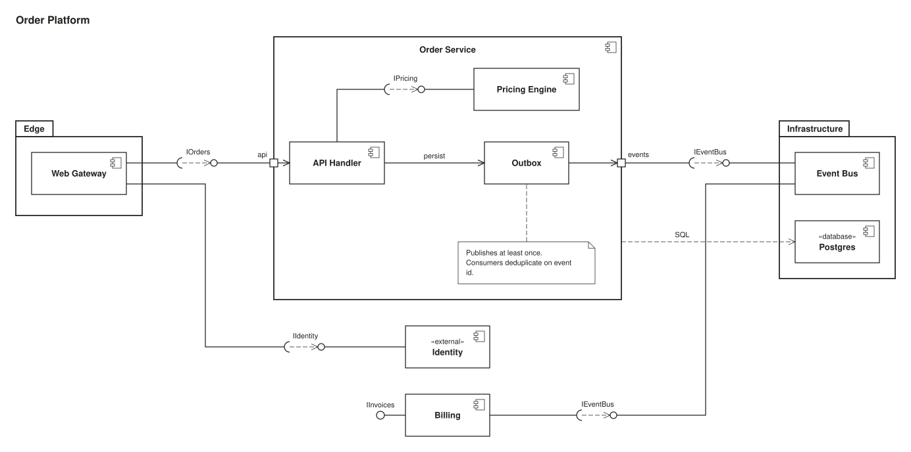
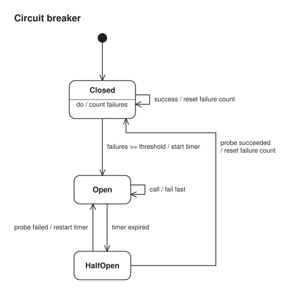
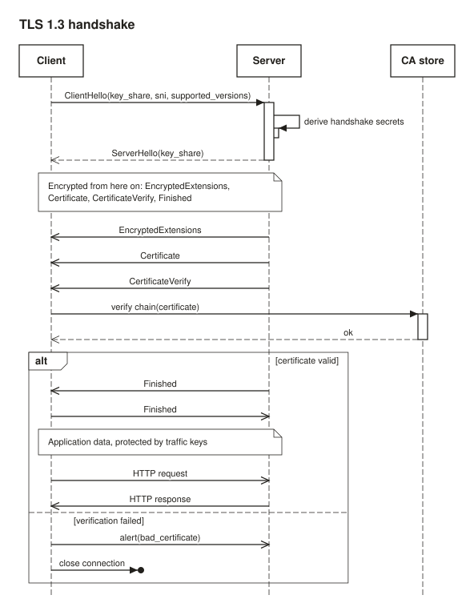
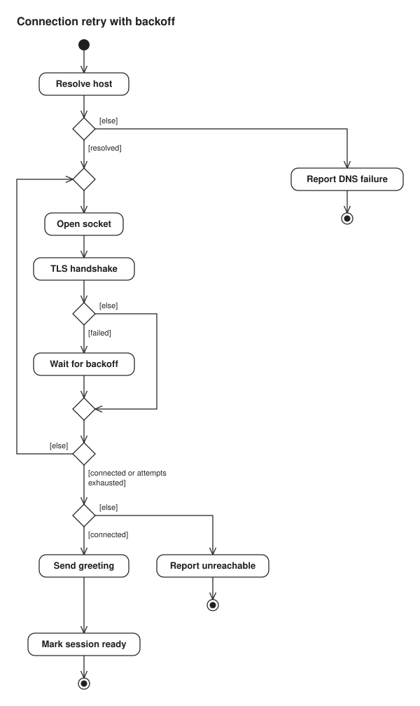
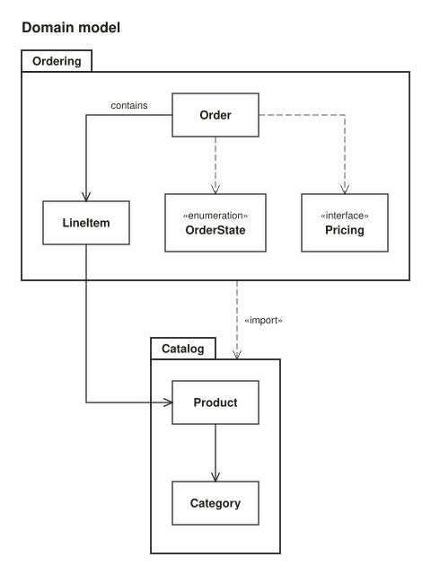
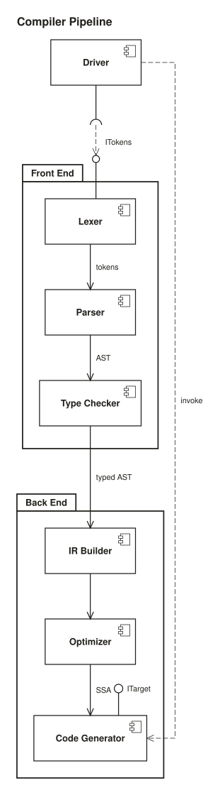

# drumlin

[](https://drumlin.ink)
[](https://github.com/davidpettersson/drumlin/actions/workflows/ci.yml)
[](https://crates.io/crates/drumlin)
[](https://davidpettersson.github.io/drumlin/)
[](https://play.drumlin.ink)
[](#license)
[](Cargo.toml)

drumlin turns a small text format into UML diagrams that look drafted by hand: aligned boxes, even
spacing, orthogonal lines and restrained lettering. You write what a diagram contains; drumlin lays it
out and writes SVG. It draws five kinds of diagram: component, package, sequence, state and activity.



**[Try it in your browser](https://play.drumlin.ink)**: the playground runs drumlin itself,
compiled to WebAssembly, so every drawing is made on your machine as you type.
**[Read the book](https://davidpettersson.github.io/drumlin/)** for every diagram kind, element and
layout rule.
**[drumlin.ink](https://drumlin.ink)** is the project's home page.

## From text to drawing

Eleven lines describe a circuit breaker:

```
diagram state "Circuit breaker"
[*] --> Closed
Closed --> Closed : success / reset failure count
Closed --> Open : failures >= threshold / start timer
Open --> Open : call / fail fast
Open --> HalfOpen : timer expired
HalfOpen --> Closed : probe succeeded / reset failure count
HalfOpen --> Open : probe failed / restart timer
state Closed {
  do / count failures
}
```

drumlin places the states, routes every transition and sets each label beside its line:

<p align="center"></p>

## Gallery

<table>
<tr>
<td align="center" valign="top" width="50%"><br><b>Sequence</b>: a TLS 1.3 handshake<br><a href="examples/tls-handshake.uml">source</a></td>
<td align="center" valign="top" width="50%"><br><b>Activity</b>: connection retry with backoff<br><a href="examples/connection-retry.uml">source</a></td>
</tr>
<tr>
<td align="center" valign="top"><br><b>Package</b>: a domain model<br><a href="examples/domain-model.uml">source</a></td>
<td align="center" valign="top"><br><b>Component</b>: a compiler pipeline<br><a href="examples/simple.uml">source</a></td>
</tr>
</table>

The drawing at the top is [`examples/orders.svg`](examples/orders.svg), rendered from
[`examples/orders.uml`](examples/orders.uml). The book has a page of examples for each kind:
[component](https://davidpettersson.github.io/drumlin/diagrams/component/examples.html),
[package](https://davidpettersson.github.io/drumlin/diagrams/package/examples.html),
[sequence](https://davidpettersson.github.io/drumlin/diagrams/sequence/examples.html),
[state](https://davidpettersson.github.io/drumlin/diagrams/state/examples.html) and
[activity](https://davidpettersson.github.io/drumlin/diagrams/activity/examples.html).

drumlin is young and written in Rust with no dependencies. The input format, the
command line and the drawings may still change between versions. The symbols follow UML 2.5.1; which
elements each diagram kind accepts, and how a drawing looks, are drumlin's own choices (see
[UML conformance](docs/src/reference/conformance.md)).

## Install and use

Install the command line from [crates.io](https://crates.io/crates/drumlin) with a Rust toolchain:

```
cargo install drumlin
```

Or build from source:

```
git clone https://github.com/davidpettersson/drumlin.git
cd drumlin
cargo build --release              # the binary is target/release/drumlin
cargo install --path . --locked    # optional: puts drumlin on your PATH
```

```
drumlin render examples/orders.uml -o orders.svg     # SVG to a file (stdout without -o)
drumlin check examples/orders.uml                    # validate only; exit code 0 when valid
drumlin render examples/orders.uml --style plain     # style: pens (default), plain or lettering
drumlin render examples/orders.uml --layout network-simplex   # layout engine: longest-path (default)
```

Output is deterministic: the same input gives byte-identical SVG. Errors have the form
`file:line:col: error: message` and suggest close matches for unknown names.

A small file:

```
diagram component "Hello"

component Client { requires IGreeting }
component Server { provides IGreeting }
```

`Client` and `Server` name the same interface, so drumlin wires them; you never draw that line.

## Runs everywhere

drumlin uses nothing beyond the Rust standard library, so it compiles cleanly wherever Rust does. CI
builds and tests it on Linux, macOS and Windows with warnings as errors, and builds the library for
WebAssembly (`wasm32-unknown-unknown`). The library is the whole program: `drumlin::render` takes the
source text and returns the SVG, with no file system, threads or network involved. That is how the
[playground](https://play.drumlin.ink) works: it loads drumlin compiled to WebAssembly and draws
in the browser, with no server doing the rendering.

## Documentation

The book in `docs/` covers getting started, every diagram kind and element, the grammar, layout hints,
error messages, the drawing principles and how layout works. Read it at
<https://davidpettersson.github.io/drumlin/>, or build and read it locally:

```
cargo install --path docs/mdbook-drumlin --locked
mdbook serve docs
```

The `mdbook-drumlin` preprocessor renders every `drumlin` code fence to inline SVG at build time, and a
diagram that fails to parse fails the build. The `Dockerfile` builds the book as a static site.

## Tests

```
cargo test --workspace
```

The unit tests sit beside the code. `tests/golden/` holds one `.uml` source and its expected `.svg` per
case, and the golden test fails when a drawing changes by a single byte. The quality test in
`src/diagrams/quality.rs` counts crossings, bends, label faults and drawing size over the golden files,
and fails when a change raises a total. When a change to the drawings is intended, regenerate the
golden files and review the new SVGs before you commit them:

```
DRUMLIN_BLESS=1 cargo test --test golden
```

## Contributing

Issues and pull requests are welcome at https://github.com/davidpettersson/drumlin. Please do not run
`cargo fmt` over existing files: the code is not rustfmt-formatted, and a reformat buries the real
change. New source files start with the copyright and SPDX lines that every existing file carries:

```
// Copyright 2026 David Pettersson
// SPDX-License-Identifier: Apache-2.0
```

The [drawing principles](docs/src/principles/introduction.md) in the book state the layout rules a
change is judged against.

## License

drumlin is licensed under the [Apache License, Version 2.0](LICENSE). Copyright 2026 David Pettersson.

If you distribute drumlin, or software that includes it, in source or binary form, you must keep the
copyright notices, include a copy of the license, and pass on the attribution in [NOTICE](NOTICE). Files
that you change must say that you changed them. Each source file carries its copyright line and an
`SPDX-License-Identifier`, so a file copied on its own still says where it came from; keep those lines.

The glyph data of the `lettering` style, `src/core/lettering/glyphs.rs`, is derived from Routed Gothic
by Darren Embry (Copyright (c) 2017, Reserved Font Name "Routed Gothic") and modified; that one file is
licensed under the [SIL Open Font License 1.1](LICENSES/OFL-1.1.txt), not under the Apache License.
Everything else in drumlin is Apache-2.0. The lettering is drumlin's own and does not carry the name
Routed Gothic.

SVG drawings that drumlin produces from your diagram sources are yours. The license puts no condition on
them, and the Open Font License puts none on documents made with the lettering.
